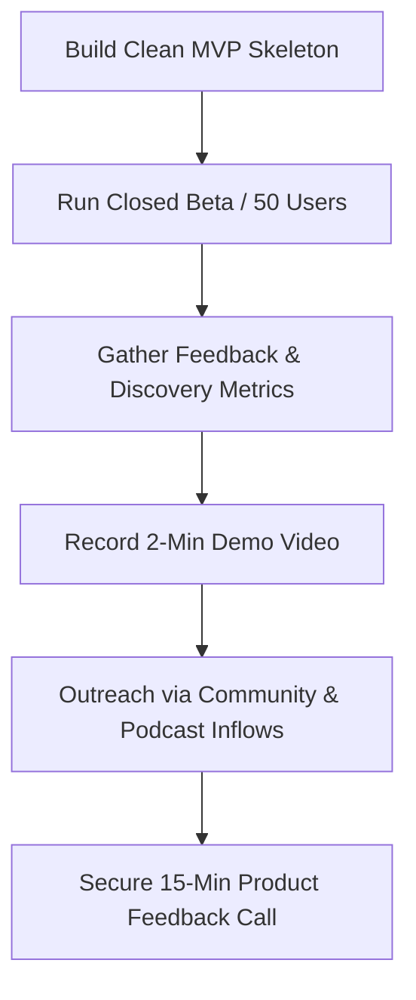

# Validation and Pitch Playbook: Complexly Academy

This document outlines a strategic roadmap to validate the "Complexly Academy" MVP with real users and prepare a professional, highly targeted pitch for the team at Complexly.

---

## Executive Summary

Complexly is a mission-driven 501(c)(3) nonprofit organization that values free, equitable education, community enrichment, and privacy. Pitching a finished product with aggressive monetization or extraction-based mechanics would be a non-starter. 

Instead, our strategy focuses on **solving discovery friction, maintaining strict compliance, and presenting the app as an open-source gift to the community.** We aim to validate user interest first, establish a small feedback loop, and then approach Complexly with **working software, enthusiastic community data, and a zero-maintenance integration model.**

---

## Part 1: Validation Blueprint (The "Proof of Interest" Stage)

Before scheduling a pitch, you must prove that the application solves a real problem for learners.

### 1. The Closed Beta Launch
Since the app is built on Kotlin Multiplatform (KMP), you can target both Android and iOS users.
*   **Target Group Size**: 30–50 active testers.
*   **Acquisition Channels**:
    *   **Reddit**: Post in [r/nerdfighters](https://reddit.com/r/nerdfighters), [r/crashcourse](https://reddit.com/r/crashcourse), and [r/scishow](https://reddit.com/r/scishow). Focus on the "nerdy student companion" aspect.
    *   **Discord**: Engage in Nerdfighteria Discord servers or educational communities.
    *   **Pitch Pitch**: *"Hey everyone, I built a privacy-first study companion for CrashCourse and SciShow that lets you organize course playlists offline and take micro-quizzes to track your learning. Looking for 30 people to test the TestFlight/Google Play build and tell me if it actually helps you study."*
*   **Testing Infrastructure**:
    *   **iOS**: Apple TestFlight (simple setup, requires Apple Developer Account).
    *   **Android**: Google Play Console Internal Testing or sharing the raw APK (since it's a tech-savvy crowd).

### 2. Core Metrics to Measure
To prove the app's value to Complexly, collect anonymous, privacy-respecting metrics (using a tool like [TelemetryDeck](https://telemetrydeck.com/) which fits the privacy-first ethos, or simple local database counters exported via a feedback button):
1.  **Search & Discovery Frequency**: How often do users utilize the search engine to cross-reference topics and filter by tags across different channels? (Validates catalog discovery).
2.  **Quiz Completion Rate**: Do users who launch a video on YouTube actually return to take and complete the quiz? (Validates the "Proof of Knowledge" loop).
3.  **Course Completion / Progression**: Do users work their way systematically through a playlist or pathway to 100% completion? (Proves intrinsic learning value).
4.  **The PMF Metric (Sean Ellis Test)**: Survey your beta testers after 2 weeks: *"How disappointed would you be if this app disappeared tomorrow? (Very Disappointed / Somewhat Disappointed / Not Disappointed)"*. Aim for **>40% "Very Disappointed"**.

---

## Part 2: The Value Proposition to Complexly

When you pitch to Complexly, you must address their nonprofit mission, educational values, and administrative constraints. 

### 1. The Three Pillars of the Pitch
Your pitch should rest on three pillars:

*   **Pillar A: Friction Reduction (Discovery Across Channels)**
    *   *The Problem*: Complexly's greatest strength is its massive library, but it is scattered across YouTube channels (CrashCourse, SciShow, Eons, Study Hall, Space Time). A user looking for resources on "photosynthesis" or "thermodynamics" has to search multiple channels separately.
    *   *Your Solution*: Complexly Academy provides a **Unified Search Index** that aggregates courses, video titles, categories, and tags. It serves as a master discovery engine that directs traffic back to their YouTube videos.
*   **Pillar B: Zero Technical Debt & Maintenance**
    *   *The Problem*: Media/nonprofit companies are highly sensitive to the long-term operational costs of software upkeep. They dread taking on legacy codebases that require dedicated engineering budgets.
    *   *Your Solution*: Frame this as a fully built, open-source project. Highlight that it is a local-first client powered by static, bundled metadata. It requires no backend server infrastructure or high-maintenance database APIs, meaning virtually **zero operational cost** for Complexly.
*   **Pillar C: Strict Legal & Platform Compliance**
    *   *The Problem*: Educational content creators rely heavily on YouTube AdSense, YouTube Premium revenue, and viewer metrics. Embedding custom video players that strip ads or disrupt analytics violates YouTube ToS and damages their revenue.
    *   *Your Solution*: The app uses native Deep Links to hand video playback off directly to the official YouTube app. This keeps YouTube happy, ensures ads run as intended, preserves Premium statuses, and routes all engagement directly to their YouTube channel metrics.

### 2. Intrinsic vs. Extrinsic Motivators
Complexly's education teams are cautious of gamification that relies on "extrinsic motivators" (e.g., points, levels, virtual stores). 
*   **The Mismatch**: Having a virtual shop or microtransactions—even for cosmetic badges or channel themes—is a hard mismatch for a 501(c)(3) nonprofit focused on free, equitable education access.
*   **The Pivot**: Frame personalization and progression around **community utility and curiosity**. 
    *   Keep progress tracking (streaks, course completion checklists) as a tool for study organization.
    *   Unlocking badges or custom layouts should be treated as milestones of academic completion (e.g., finishing "CrashCourse History of Science" unlocks the corresponding completion certificate).
    *   Direct all monetization outward: use completion screens as natural funnels to the **DFTBA Store** (to buy physical posters/notebooks) or to their **Patreon** campaigns.

---

## Part 3: Outreach & Networking Playbook

Because Complexly is an internet-native company, typical corporate cold emails to general mailboxes are rarely effective. Instead, outreach should target mid-level leaders who bridge content strategy, marketing, and educational implementation.

### 1. Key Strategic Contacts

Based on Complexly's organizational structure, the most effective targets for this application are:

*   **Heather DiDiego (Director of Content Strategy & Growth)**
    *   *Role*: Leads audience growth and content placement strategy across the organization.
    *   *Why*: The app is a unified discovery layer. It directly solves the problem of "channel fragmentation" (where users cannot easily search cross-channel topics) and acts as a funnel to drive organic traffic back to YouTube and store/Patreon links.
    *   *Pitch Hook*: Highlight how the app acts as a zero-cost growth funnel and content discovery tool that binds their disparate channels (Crash Course, SciShow, Eons) into a unified learning pathway.
*   **Matthew Gaydos (Marketing Manager)**
    *   *Role*: Former creator/producer of *Journey to the Microcosmos*, now managing brand marketing.
    *   *Why*: He understands community sentiment, audience engagement, and creator-led software. He is approachable, highly plugged into community spaces, and can quickly identify if this has community traction.
    *   *Pitch Hook*: Focus on community value, brand alignment, and how the tool could be shared as a "community-first" resource for Nerdfighteria.
*   **Madeline Doering (Editorial Director - Study Hall) & Nick Jenkins (Executive Producer - Study Hall)**
    *   *Role*: Editorial and production leaders for the *Study Hall* program.
    *   *Why*: Study Hall is Complexly's flagship initiative for formal educational partnerships, college readiness, and credit-bearing courses. The curriculum-centric companion concept matches Study Hall's academic structure perfectly.
    *   *Pitch Hook*: Focus on educational utility, structured learning pathways, and enabling students to systematically work through the Study Hall video catalog.
*   **Kelsey Savage (Chief Development Officer)**
    *   *Role*: Handles sponsorships and underwriting.
    *   *Why*: If they want a formal partnership, she will understand how sponsorship and donor appreciation flow through their digital assets.
    *   *Pitch Hook*: Demonstrate that the app respects their underwriting and sponsorships by deep-linking directly to YouTube (which keeps pre-rolls and mid-rolls intact) and offers potential placement for nonprofit underwriting banners.

### 2. Tailored Outreach Templates

#### Template A: Reaching out to Heather DiDiego (Growth & Content Strategy)
> **Subject**: fan project: Unified discovery layer app for Complexly educational channels
>
> Hi Heather,
>
> I hope you're doing well.
>
> As a mobile developer and long-time supporter of Complexly, I built an open-source, privacy-first mobile companion app called **Complexly Academy** (targeting Android & iOS using Kotlin Multiplatform). 
>
> I built this to solve a specific user friction: finding and cross-referencing topics (like "photosynthesis" or "thermodynamics") that are scattered across different channels like Crash Course, SciShow, and Eons. The app indexes these channels into a single, unified local search engine.
>
> Key design points that respect Complexly's 501(c)(3) mission:
> 1. **Growth Funnel**: Hands off video playback directly to the official YouTube app via deep links, keeping your AdSense, Premium revenue, and engagement metrics 100% intact.
> 2. **Patreon & DFTBA Integration**: Prompts users to support DFTBA and Patreon campaigns directly upon course completion.
> 3. **Zero Maintenance**: Structured as a local-first client running on static metadata. It requires no backend server infrastructure (zero operational costs for your team).
>
> We currently have a small beta test running with [X] community members to validate utility. I would love to share a quick 90-second video demo showing how the unified search and quiz retention system work to see if this is something Complexly would be interested in supporting or sharing with the community.
> 
> You can view the quick demo here: `[Link to Loom/Video Demo]`
>
> Would you be open to sharing some feedback on this approach?
>
> Best regards,
>
> **[Your Name]**  
> Mobile Software Engineer  
> `[Your Portfolio Link]`

#### Template B: Reaching out to Matthew Gaydos (Marketing & Community)
> **Subject**: Open-source study client for CrashCourse & SciShow (Complexly Academy)
>
> Hi Matthew,
>
> I'm a developer and community member who has followed Complexly's growth since the early DFTBA days. 
>
> I wanted to share a fan project I've been working on to solve a discovery problem for students. I've built **Complexly Academy**, an open-source, privacy-first companion app that allows students to search cross-channel topics, track study progress, and take hand-curated micro-quizzes.
>
> To align with the community's values:
> - The app has no microtransactions, points, or ads. It is entirely local-first and privacy-respecting.
> - Video playback deep-links directly to the YouTube app so all views and ad revenue go straight to the official channels.
> - Completion screens actively direct students to support your Patreon and DFTBA stores.
>
> I've recorded a short 90-second demo of the app in action: `[Link to Loom/Video Demo]`
>
> Before releasing it to the wider community, I wanted to run it by you to ensure it aligns with your brand guidelines and community strategy. I'd love to know what you think!
>
> Best,
>
> **[Your Name]**  
> Mobile Software Engineer  
> `[Your Portfolio Link]`
  

---

## Part 4: Technical Polish Before Pitching

Before recording your demo video or sharing the app, ensure the codebase reflects these decisions:

1.  **Remove Monetization Code**: Ensure there are no traces of virtual stores, coins, or premium cosmetic unlocks in the UI. 
2.  **Highlight Community Support**: Keep the "Merch Shelf" and Patreon calls styled as external support hooks rather than commercial items.
3.  **Local API Adaptability**: Decouple the UI from the database structure so that if they request to seed the app from a future official REST API instead of a local JSON bundle, it can be integrated effortlessly.
4.  **No Copyright Violations in the Demo**: Use official channel names but avoid claiming the app is "The Official Complexly App" in the copy. Label it clearly as an "Open-Source Community Companion Client."

## Part 5: App Naming Strategy & Contingency Plan

To balance high-impact pitch alignment with trademark compliance, the project follows a two-phase naming strategy:

### Phase A: Closed Beta & Pitch (Targeted Prototype)
*   **App Name**: `Complexly Academy`
*   **Rationale**: Maximizes interest during the pitch by showing a fully tailored, first-party style companion. It visualizes the exact experience Complexly's audience would have.
*   **Beta Precautions**:
    *   Keep all TestFlight and Google Play Internal builds strictly **closed** (shared only via private links or direct invite to target testers, never search-indexed or advertised publicly).
    *   Include a clear disclaimer in the beta description: *"An unofficial fan-built study companion prototype, created for testing and feedback purposes."*

### Phase B: Public Pivot (General Release)
*   **App Name**: `Pocket Scholar` (or `Pocket Scholar: Study Companion`)
*   **Trigger**: If Complexly requests a name change during the pitch, or if they decline a partnership and you decide to open the client to the public.
*   **Scope Expansion**:
    *   Rebrand the app stores and launcher titles to `Pocket Scholar`.
    *   Expand the database schema and content index to aggregate other premium educational YouTube channels (e.g., Kurzgesagt, Veritasium, TED-Ed, 3Blue1Brown).

---

> [!TIP]
> **Actionable Next Step**: 
> 1. Focus your catalog entirely on 3-5 core courses (e.g., CrashCourse Chemistry, SciShow Space) with hand-curated metadata and 3-question quizzes.
> 2. Record a crisp, 2-minute video demonstrating:
>    - How fast the search indexes content across channels.
>    - How the app deep-links cleanly into YouTube.
>    - How completing a course prompts the user to support the channel on Patreon or DFTBA.
> 3. Reach out to the ed-tech leads on LinkedIn or submit the demo link to the podcast email to get initial feedback.
